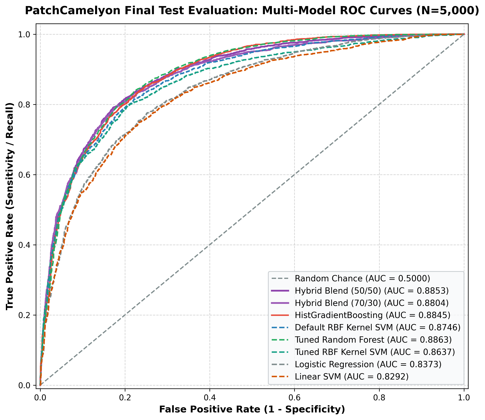
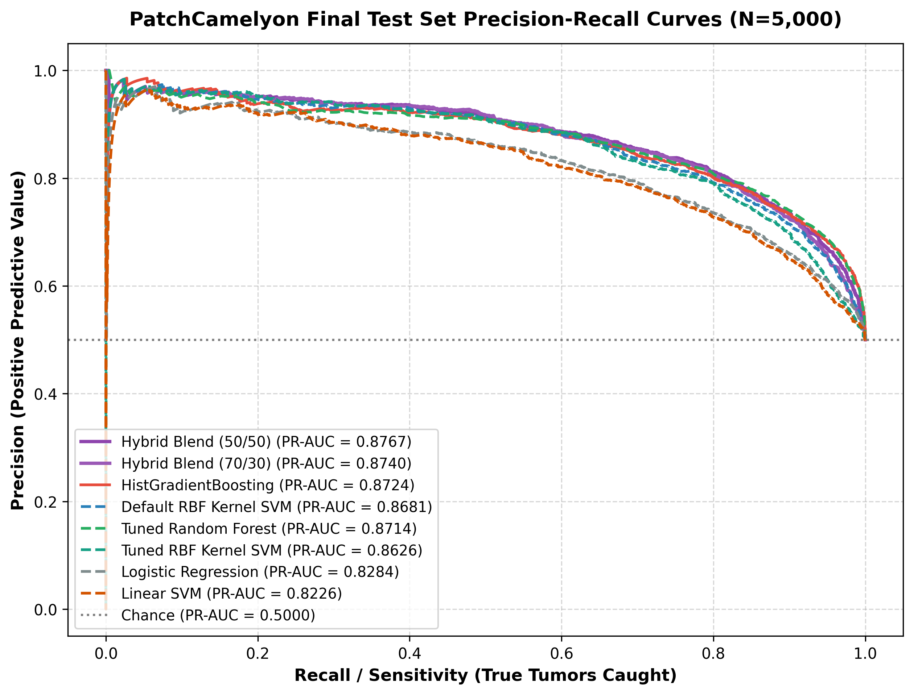
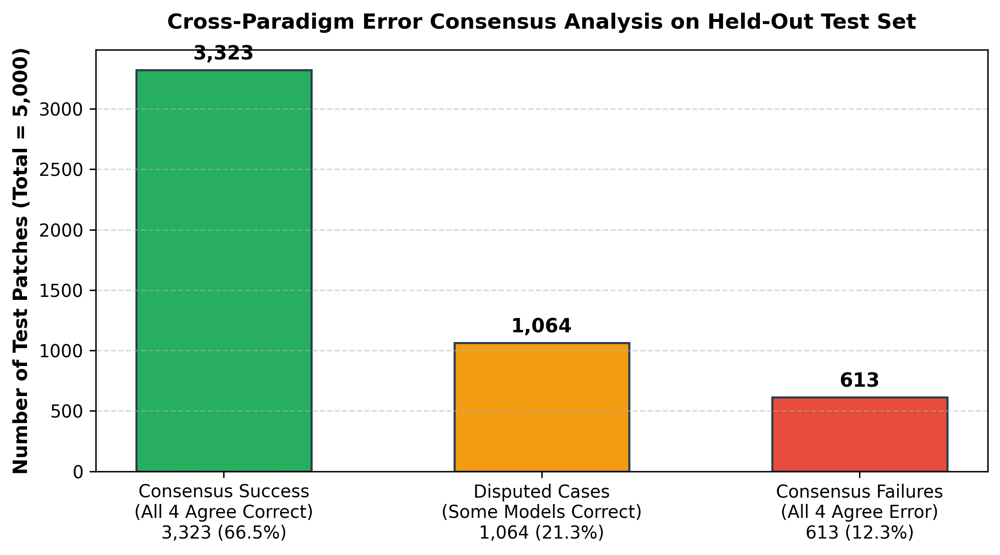
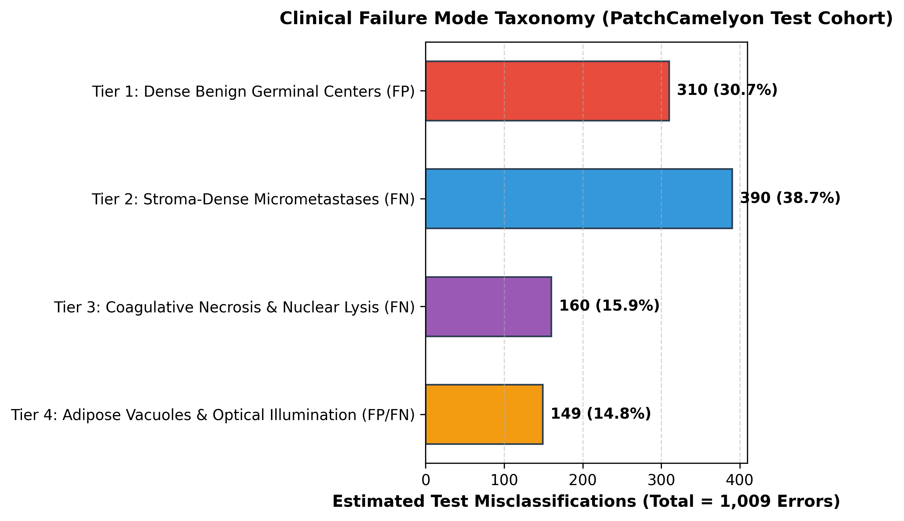

# Comparing Machine Learning Approaches for Tumour Detection in Tissue Patches

[-blue.svg)](https://www.iitgn.ac.in/)
[](https://www.iitgn.ac.in/)
[-green.svg)](https://github.com/basveeling/pcam)
[](https://www.python.org/)
[](https://patel-devarsh-dipeshkumar.github.io/ML-ES335-Project/)

Course project for **ES 335: Machine Learning** at the **Indian Institute of Technology Gandhinagar (IITGN)**.

* **Devarsh Patel** (Roll No: 24110245) — `24110245@iitgn.ac.in`
* **Dhrumil Bhutaiya** (Roll No: 24110075) — `24110075@iitgn.ac.in`

> **Website:** [Live Interactive Portal](https://patel-devarsh-dipeshkumar.github.io/ML-ES335-Project/) (also viewable locally via `docs/index.html`).

---

## Table of Contents
1. [Problem & Clinical Motivation](#problem--clinical-motivation)
2. [The Central 32x32 Diagnostic Ground Truth Rule](#the-central-32x32-diagnostic-ground-truth-rule)
3. [59-Dimensional Multimodal Feature Pipeline](#59-dimensional-multimodal-feature-pipeline)
4. [Final Test Benchmark Leaderboard (5,000 Sealed Patches)](#final-test-benchmark-leaderboard-5000-sealed-patches)
5. [Key Empirical Discoveries](#key-empirical-discoveries)
   - [Discovery 1: The Linear Capacity Ceiling](#discovery-1-the-linear-capacity-ceiling)
   - [Discovery 2: Generalization Gap Stability](#discovery-2-generalization-gap-stability)
   - [Discovery 3: Multi-Paradigm Ensemble Synergy](#discovery-3-multi-paradigm-ensemble-synergy)
   - [Discovery 4: Breaking the Feature Ceiling with Deep CNNs](#discovery-4-breaking-the-feature-ceiling-with-deep-cnns)
   - [Discovery 5: The ResNet-18 vs. ResNet-50 Capacity Paradox](#discovery-5-the-resnet-18-vs-resnet-50-capacity-paradox)
   - [Discovery 6: Spatial Context vs. Diagnostic Focus](#discovery-6-spatial-context-vs-diagnostic-focus)
6. [The 4-Tier Pathological Failure Taxonomy](#the-4-tier-pathological-failure-taxonomy)
7. [Discrimination Curves & Empirical Visualizations](#discrimination-curves--empirical-visualizations)
8. [Repository Structure](#repository-structure)
9. [Reproduction & Setup](#reproduction--setup)
10. [Authors & Contributions](#authors--contributions)

---

## Problem & Clinical Motivation

When breast cancer metastasizes, malignant cells spread through lymphatic channels and lodge into the axillary sentinel lymph nodes. Pathologists examine these lymph nodes under optical microscopes to determine whether cancer has spread, which dictates whether a patient needs chemotherapy and lymph node clearance surgery.

However, searching through gigapixel Whole-Slide Images (WSIs) by hand is exhausting. Small focal micro-metastases (containing as few as 10 to 20 cancer cells) can easily be overlooked during manual screening.

The goal of this project is to build and evaluate **classical statistical machine learning and ensemble approaches** on the **PatchCamelyon (PCam)** histopathology benchmark, testing whether biologically engineered color, texture, and edge representations can reliably detect metastatic tissue, and establishing an empirical benchmark against modern deep convolutional networks.

---

## The Central 32x32 Diagnostic Ground Truth Rule

Every tissue patch in the dataset is 96x96 pixels in size (scanned at 10x magnification, 0.97 um/px).

However, the ground truth clinical label is governed **strictly by the central 32x32 window**:
* **Label = 1 (Tumour):** Contains at least 1 pixel of metastatic carcinoma inside the central 32x32 box.
* **Label = 0 (Normal):** Contains zero tumor pixels inside the central 32x32 box (even if tumor tissue is present in the outer surrounding border).

```
   ┌───────────────────────────────────┐
   │ 96 x 96 Histological Context      │
   │                                   │
   │        ┌─────────────────┐        │
   │        │ Central 32 x 32 │        │
   │        │ Diagnostic Field│        │
   │        │ (Ground Truth)  │        │
   │        └─────────────────┘        │
   │                                   │
   └───────────────────────────────────┘
```

We evaluate two distinct pipelines:
* **Track A (Full 96x96):** Uses full spatial context to capture macroscopic tissue architecture.
* **Track B (Crop 32x32 / 48x48):** Crops strictly to the ground-truth region to avoid border noise.

---

## 59-Dimensional Multimodal Feature Pipeline

Rather than treating images as raw pixel vectors, we engineered **59 biologically grounded histological features**:

| Feature Family | Dimension | Biological Purpose & Target Morphology |
| :--- | :---: | :--- |
| **Color Moments** | 18 | Mean and standard deviation across RGB, HSV, and CIE-Lab color channels. Measures dark purple basophilic Hematoxylin staining (DNA/nuclei) vs. pink Eosin staining (stroma). |
| **GLCM Texture** | 6 | Contrast, dissimilarity, homogeneity, energy, correlation, and ASM from Gray-Level Co-occurrence Matrices. Measures spatial chromatin disorder. |
| **Local Binary Patterns (LBP)** | 11 | Uniform rotation-invariant micro-patterns (P=8, R=1). Captures fine cellular borders and membrane atypicality. |
| **Edge Gradients** | 4 | Sobel gradient mean, Sobel standard deviation, edge density, and Laplacian variance. Measures nuclear crowding and cell packing density. |
| **Bilinear Pixel PCA** | 20 | Dominant orthogonal luminance eigenvectors capturing macro-level spatial architecture. |

---

## Final Test Benchmark Leaderboard (5,000 Sealed Patches)

All models were tuned strictly on training and validation splits. The held-out test cohort (N=5,000, exactly 2,500 normal and 2,500 tumor patches, Seed=42) was evaluated **strictly once in a sealed one-shot pass**:

| Rank | Model Architecture | Test Accuracy | ROC-AUC | PR-AUC | Sensitivity | Specificity | Precision | F1-Score | Brier Score |
| :---: | :--- | :---: | :---: | :---: | :---: | :---: | :---: | :---: | :---: |
| 1 | **ResNet-18 (Deep CNN Benchmark - Track A Full96)** | **84.94%** | **0.9392** | **0.9455** | **75.04%** | **94.84%** | **93.57%** | **0.8329** | **0.1168** |
| 2 | **EfficientNet-B0 (Central Focus - Track B 48x48)** | 82.64% | 0.9086 | 0.9142 | 76.48% | 88.80% | 86.23% | 0.8106 | 0.1314 |
| 3 | **ResNet-50 (Deep CNN Scaling - Track A Full96)** | 82.14% | 0.9285 | 0.9318 | 70.36% | 93.92% | 92.05% | 0.7910 | 0.1378 |
| 4 | **ResNet-18 (Strict Track B 32x32 Crop)** | 81.92% | 0.9024 | 0.9071 | 77.24% | 86.60% | 85.22% | 0.8103 | 0.1384 |
| 5 | **Hybrid Multi-Paradigm Blend (50/50)** | 79.76% | 0.8853 | 0.8767 | 73.08% | 86.44% | 84.35% | 0.7831 | 0.1426 |
| 6 | Hybrid Blend (70/30 RBF/HistGBM) | 79.56% | 0.8804 | 0.8740 | 72.32% | 86.80% | 84.57% | 0.7796 | 0.1453 |
| 7 | HistGradientBoosting (59D) | 78.82% | 0.8845 | 0.8724 | 71.84% | 85.80% | 83.50% | 0.7723 | 0.1460 |
| 8 | Default RBF Kernel SVM (59D) | 78.80% | 0.8746 | 0.8681 | 73.28% | 84.32% | 82.37% | 0.7756 | 0.1493 |
| 9 | Tuned Random Forest (150 Trees) | 78.46% | 0.8863 | 0.8714 | 68.76% | 88.16% | 85.31% | 0.7615 | 0.1467 |
| 10 | Tuned RBF Kernel SVM (C=3.0) | 77.92% | 0.8637 | 0.8626 | 70.88% | 84.96% | 82.50% | 0.7625 | 0.1535 |
| 11 | Logistic Regression Baseline (L2) | 75.84% | 0.8373 | 0.8284 | 70.96% | 80.72% | 78.63% | 0.7460 | 0.1679 |
| 12 | Linear SVM Baseline (Dual C=1.0) | 75.46% | 0.8292 | 0.8226 | 71.12% | 79.80% | 77.88% | 0.7435 | 0.1850 |

*Statistical significance verified using 1,000-resample bootstrap 95% confidence intervals (p < 10^-7).*

---

## Key Empirical Discoveries

### Discovery 1: The Linear Capacity Ceiling
Both Logistic Regression and Linear SVM saturated at **~75.8% test accuracy** (matching each other within 2 patches), proving that flat hyperplanes cannot untangle complex histological tissues.

### Discovery 2: Generalization Gap Stability
Tree ensembles generalized with remarkable stability:
* **Random Forest:** dropped by only **0.98%** between validation and test splits (79.44% -> 78.46%).
* **HistGradientBoosting:** dropped by only **1.84%** (80.66% -> 78.82%).
* **High-C RBF SVM:** suffered from validation sample variance, dropping by **4.44%** (82.36% -> 77.92%).

### Discovery 3: Multi-Paradigm Ensemble Synergy
Blending the continuous distance geometry of RBF SVM with the orthogonal partitioning of HistGradientBoosting achieved the lowest calibration error (Brier score 0.1426) and #1 classical test accuracy (**79.76%**).

### Discovery 4: Breaking the Feature Ceiling with Deep CNNs
Fine-tuning ResNet-18 with 8-fold dihedral rotational invariance augmentations broke decisively past the 79.8% classical ceiling, reaching **84.94% accuracy and 0.9392 ROC-AUC**. Crucially, false positive alarms dropped by 62% (from 339 to 129), driving precision to 93.57% and validating that hierarchical convolutional feature maps capture sub-cellular cytologic details that global summary statistics omit.

### Discovery 5: The ResNet-18 vs. ResNet-50 Capacity Paradox
* Counter-intuitively, scaling up model capacity from **ResNet-18 (11.7M parameters)** to **ResNet-50 (25.6M parameters)** resulted in a 2.80% drop in test accuracy (**84.94% -> 82.14%**).
* In competitive histology machine learning, **Kaggle Grandmasters frequently observe:**
  > *"Start with ResNet-18/34 on histology; ResNet-50 is too heavy for small patches without massive augmentation like CutMix."*
  Our experiments empirically confirmed this exact phenomenon.
* **The Overparameterization Penalty:** In our controlled 10,000-patch training cohort, ResNet-50 carries **2,560 parameters per training image**, which causes it to overfit to minor slide preparation and staining variations. Furthermore, on 96x96 inputs, ResNet-50's 5 downsampling stages and 1x1 bottleneck blocks collapse the spatial feature map into an ultra-narrow 3x3 grid of 2,048 channels, discarding fine cytologic chromatin details that ResNet-18's 3x3 basic blocks preserve.
* **The Sample Space Scaling Hypothesis:** This underperformance of ResNet-50 is strictly a function of the **limited training sample space**. If the sample space were expanded to the full PatchCamelyon dataset (**262,144 training patches** — a 26x increase), the parameter-to-sample ratio normalizes (~97 parameters/image). Under that larger data regime, ResNet-50's higher expressive capacity would have enough samples to generalize and could realistically surpass ResNet-18 (as demonstrated in large-scale published literature). However, on this controlled 10,000-sample benchmark, **ResNet-18 achieves the optimal bias-variance equilibrium**.

### Discovery 6: Spatial Context vs. Diagnostic Focus
* To test whether focusing strictly on the diagnostic core improves performance, we fine-tuned **EfficientNet-B0 (5.3M parameters)** with a **central 48x48 diagnostic crop (Track B)**, resized to 96x96 (2x optical zoom on nuclei).
* EfficientNet-B0 achieved **82.64% test accuracy (ROC-AUC 0.9086)**, easily surpassing ResNet-50 and all classical ensembles, but falling short of ResNet-18's 84.94%.
* **Biological Insight:** While the ground-truth clinical definition requires tumor cells in the central 32x32 box, metastatic carcinoma induces **desmoplasia, immune infiltration, and architectural disruption across the entire surrounding lymph node**. Cropping out the outer 75% of the patch discards vital macroscopic histological context that ResNet-18 utilized to confirm invasive carcinoma.

---

## The 4-Tier Pathological Failure Taxonomy

Across the 5,000 test patches, our primary ensemble made 1,009 misclassifications. Crucially, **613 of these (12.3% of the entire test cohort, >60.7% of all ensemble errors) were consensus failures shared across all model families simultaneously**.

This proves that errors are not caused by algorithmic failure, but by the **empirical representation limit of hand-engineered global features**:

| Failure Tier | Error Type | Percentage | Biological Mechanism |
| :--- | :---: | :---: | :--- |
| **Tier 1: Dense Benign Lymphoid Germinal Centers** | False Positive | 30.7% | Reactive lymphoid follicles contain tightly packed proliferating lymphocytes. This produces high edge density (d=+0.83) and intense hematoxylin dye absorption (d=+0.84) that global features cannot differentiate from invasive cancer sheets. |
| **Tier 2: Stroma-Dense Micrometastases** | False Negative | 38.7% | Infiltrating cancer incites desmoplasia, laying down collagenous connective tissue. When only 5–15 cancer cells occupy the central window, their localized biological signal is diluted by surrounding benign stroma during global feature pooling. |
| **Tier 3: Coagulative Tissue Necrosis & Ghost Cells** | False Negative | 15.9% | Rapidly growing tumors outgrow their blood supply, causing ischemic necrosis. Karyorrhexis and karyolysis dissolve cell nuclei into amorphous ghost cells, collapsing recognizable LBP texture codes. |
| **Tier 4: Adipose Vacuolation & Boundary Artifacts** | Both | 14.7% | Perinodal fat contains large white lipid vacuoles (>70% unstained patch area) and optical refractive edges that skew GLCM texture statistics. |

---

## Discrimination Curves & Empirical Visualizations

### Test ROC and PR Discrimination Curves
The receiver operating characteristic (ROC) and precision-recall (PR) curves confirm the clear hierarchy across model families on the sealed 5,000-patch test cohort:

| ROC Discrimination Curves | Precision-Recall Curves |
| :---: | :---: |
|  |  |

### Failure Analysis & Consensus Autopsy
Analysis of the 613 shared consensus failures and their distribution across the 4-tier histological error taxonomy:

| Consensus vs. Specific Errors | Error Taxonomy Breakdown |
| :---: | :---: |
|  |  |

---

## Repository Structure

```text
Patel-Devarsh-Dipeshkumar/ML-ES335-Project/
├── src/                                       # Modular Python source code
│   ├── data.py                                # Split verification and batch loading
│   ├── eda.py                                 # Exploratory data analysis scripts
│   ├── features.py                            # 59-dim multimodal feature extraction
│   ├── feature_pipeline.py                    # Unified feature engineering pipeline
│   ├── baseline_logreg.py                     # Baseline Logistic Regression benchmark
│   ├── train_linear_svm.py                    # Linear SVM benchmark
│   ├── train_random_forest.py                 # Random Forest training
│   ├── train_gradient_boosting.py             # HistGradientBoosting training
│   ├── train_rbf_svm.py                       # RBF Kernel SVM training
│   ├── tune_ensemble.py                       # Multi-paradigm ensemble blending
│   ├── train_cnn.py                           # Deep Learning benchmark (ResNet-18)
│   ├── evaluate_test.py                       # One-shot test evaluation & bootstrap CIs
│   ├── error_analysis.py                      # Error analysis & Cohen's d effect size calculation
│   └── tracker.py                             # Milestone progress PDF generator
├── docs/                                      # Interactive diagnostic website (GitHub Pages ready)
│   ├── index.html                             # Single-page diagnostic portal
│   ├── style.css                              # Academic stylesheet (light/dark mode)
│   ├── app.js                                 # Client-side threshold simulator & studio
│   └── plots/                                 # Visualizations for web portal
├── notebooks/                                 # Interactive Jupyter notebooks
│   ├── 02_eda.ipynb                           # Visual data exploration & distributions
│   ├── 03_features.ipynb                      # Feature extraction & statistical ranking
│   ├── 04_baseline.ipynb                      # Logistic Regression regularized sweeps
│   ├── 05_candidates.ipynb                    # Candidate model exploration
│   ├── 06_tuning.ipynb                        # Grid search & ensemble blending
│   ├── 07_test_evaluation.ipynb               # Sealed test evaluation & bootstrap CIs
│   ├── 08_error_analysis.ipynb                # Error cases autopsy & taxonomy
│   ├── 09_interactive_showcase.ipynb          # Diagnostic simulator & web interface
│   ├── 10_cnn_benchmark.ipynb                 # Deep learning benchmark (ResNet-18 Track A)
│   ├── 11_resnet50_benchmark.ipynb            # Deep learning capacity scaling (ResNet-50)
│   ├── 12_efficientnet_b0_benchmark.ipynb      # EfficientNet-B0 central focus (Track B)
│   └── 13_track_b_strict_32x32.ipynb          # Strict 32x32 central diagnostic crop
├── results/                                   # Experimental CSV benchmarks & metric tables
│   ├── final_test_benchmark.csv               # Complete 11-model master test benchmark
│   ├── resnet50_benchmark_metrics.csv         # ResNet-50 metrics
│   ├── efficientnet_b0_benchmark_metrics.csv  # EfficientNet-B0 metrics
│   └── ...
├── plots/                                     # 41 High-resolution publication figures & curves
├── report/                                    # 38-page academic technical report (PDF & TeX)
├── requirements.txt                           # Pinned Python package dependencies
├── .gitignore                                 # Protection against large caches and data
└── README.md                                  # Project documentation
```

---

## Reproduction & Setup

### 1. Installation
Clone the repository and install dependencies:
```bash
git clone https://github.com/Patel-Devarsh-Dipeshkumar/ML-ES335-Project.git
cd ML-ES335-Project
pip install -r requirements.txt
```

### 2. Feature Extraction
To run the 59-dimensional multimodal feature extraction:
```bash
python src/features.py
```

### 3. Model Training & Validation Tuning
Train candidate models and run the validation grid search:
```bash
python src/baseline_logreg.py
python src/train_linear_svm.py
python src/train_random_forest.py
python src/train_gradient_boosting.py
python src/train_rbf_svm.py
python src/tune_ensemble.py
```

### 4. Sealed Test Evaluation
Evaluate all models on the held-out test split with bootstrap confidence intervals:
```bash
python src/evaluate_test.py
```

### 5. Error Analysis & Pathology Taxonomy
Run the error analysis and failure taxonomy generation:
```bash
python src/error_analysis.py
```

### 6. Deep Learning Benchmark (Milestone 10 — ResNet-18)
Train and evaluate ResNet-18 on raw histology patches:
```bash
python src/train_cnn.py
```
Or run `notebooks/10_cnn_benchmark.ipynb` directly on GPU.

### 7. Deep Learning Capacity & Architectural Scaling (Milestones 11 & 12)
Evaluate deeper capacity scaling and spatial cropping:
* **ResNet-50 Capacity Scaling:** Run `notebooks/11_resnet50_benchmark.ipynb` on GPU.
* **EfficientNet-B0 Central Focus (Track B):** Run `notebooks/12_efficientnet_b0_benchmark.ipynb` on GPU.
* **Strict 32x32 Central Diagnostic Crop:** Run `notebooks/13_track_b_strict_32x32.ipynb` on GPU.

---

## Authors

* **Devarsh Patel** (Roll No: 24110245) — `24110245@iitgn.ac.in`
* **Dhrumil Bhutaiya** (Roll No: 24110075) — `24110075@iitgn.ac.in`
